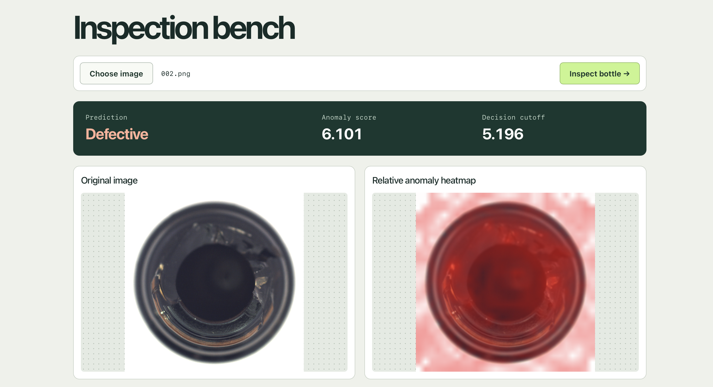
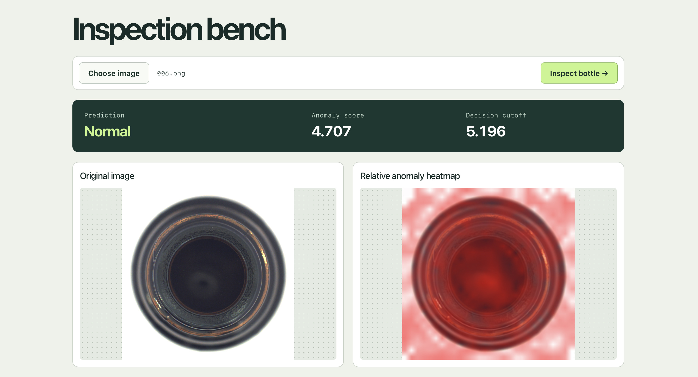
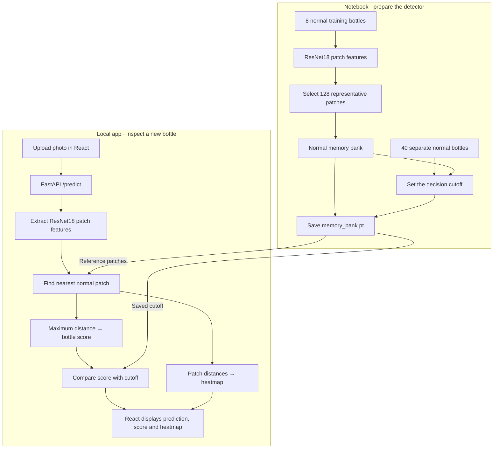

# Few-Shot Industrial Anomaly Detection Using PatchCore

A local bottle inspection app built with React, FastAPI and PyTorch. Upload a bottle photo to see a Normal or Defective prediction, an anomaly score, and a relative heatmap alongside the original image.

## Demo

### Defective bottle

The detector scored this bottle at **6.101**, above the **5.196** cutoff.

### Normal bottle

The score fell below the cutoff, so the detector labeled this bottle **Normal**.
Red shows the most unusual regions within each photo, so it can also appear on a normal bottle.

## Project architecture

The notebook prepares the detector once. The app then reuses the saved detector for each uploaded bottle photo.

For evaluation, the notebook scores 83 separate test bottles. Image labels check the Normal or Defective decision, and ground-truth masks check where the detector highlights defects.

## How the detector works

This is an educational PatchCore-inspired implementation. A frozen ImageNet-pretrained ResNet18 extracts two feature grids from a 224 × 224 RGB image. The detector aligns layers 2 and 3 and concatenates them into 384-dimensional descriptors at 28 × 28 locations.

Eight normal training images supply the patch memory bank. With a fixed seed of 42, the notebook samples up to 2,048 candidate patches and uses greedy farthest-point selection to retain 128 representatives. At inference, each patch receives its Euclidean distance to its nearest representative. The maximum patch distance is the image score. The notebook uses the 95th percentile of scores from 40 separate normal training images as the decision cutoff.

Compared with the original research architecture, this version uses a smaller ResNet18 backbone, a sampled coreset, and a plain maximum nearest-neighbour score. It was evaluated on the bottle category only.

## Measured results

Recorded on a MacBook Air M1 using the MVTec AD bottle test split. The threshold was set before scoring the test images.

| Metric | Result |
|---|---:|
| Test bottles | 83 |
| Decision cutoff (rounded) | 5.196 |
| Correct decisions | 78 / 83 (94.0%) |
| Defective bottles detected | 58 / 63 (92.1%) |
| Good bottles accepted | 20 / 20 |
| Image ROC-AUC | 0.990 |
| Pixel ROC-AUC at 224 × 224 | 0.967 |

| Actual label | Predicted Normal | Predicted Defective |
|---|---:|---:|
| Normal | 20 | 0 |
| Defective | 5 | 58 |

The five misses comprised one small break and four contamination cases. In one local inspection, a broken bottle named 003.png scored **5.817**, above the cutoff. Another uploaded image, 006.png, scored **4.707** and received a Normal prediction. The displayed overlay scales colors separately for each image, so a red region can also appear on a normal bottle. The score is a distance, not a probability.

## Run locally

Use Python 3.11 and a Node.js version supported by the frontend's Vite version. From the repository root, activate your Python environment and install the dependencies:

~~~bash
python -m pip install -r requirements.txt
~~~

### Prepare the detector

1. Open the [official MVTec AD dataset page](https://www.mvtec.com/company/research/datasets/mvtec-ad).
2. Go to the dataset downloads and select **Bottle (148 MB)**.
3. Extract the `bottle` folder into `data/mvtec_anomaly_detection/`. Check that `data/mvtec_anomaly_detection/bottle/train/good/` contains `.png` images.

Open the project notebook in Jupyter and run the cells in order. The export cell writes models/memory_bank.pt. The revision notebook supports running from the repository or its notebooks folder. If using the original notebook with a hard-coded project path, set project_root and the initial image folder to your local checkout. The first ResNet18 run downloads pretrained weights. The saved checkpoint and raw dataset are excluded from version control.

### Start the API

~~~bash
python -m uvicorn api:app --host 127.0.0.1 --port 8000
~~~

Open http://127.0.0.1:8000/docs to test POST /predict with a bottle photo.

### Start React

In a second terminal, from the repository root:

~~~bash
cd frontend
npm install
npm run dev
~~~

Open the local URL printed by Vite. Select a test image and click **Inspect bottle**. The development proxy forwards /predict to the API on port 8000. Use the overlay slider to compare the highlighted region with the original bottle.

## Project files

| Path | Purpose |
|---|---|
| notebooks/ | Experiment, evaluation, visualization and checkpoint export |
| api.py | Image upload, inference and heatmap response |
| frontend/ | React inspection interface and Vite configuration |
| models/memory_bank.pt | Locally generated memory bank and calibration settings |
| data/mvtec_anomaly_detection/bottle/ | Local dataset |

## Limitations and future experiments

The reported results cover one category and one sampling seed. Repeat the experiment with different normal-image selections, review the missed contamination images against their masks, and reserve separate validation data for any further threshold tuning.

